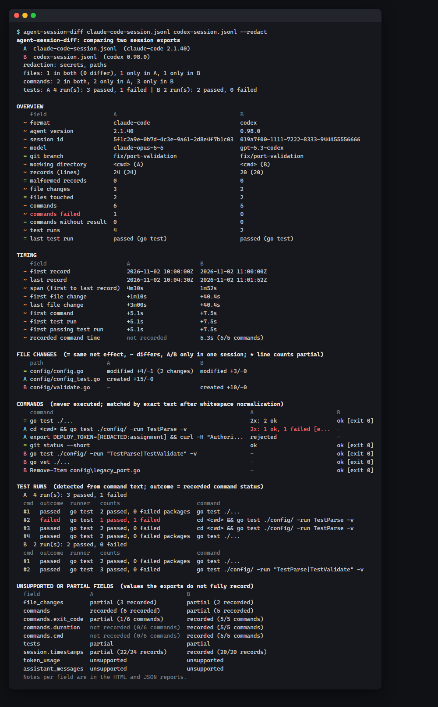
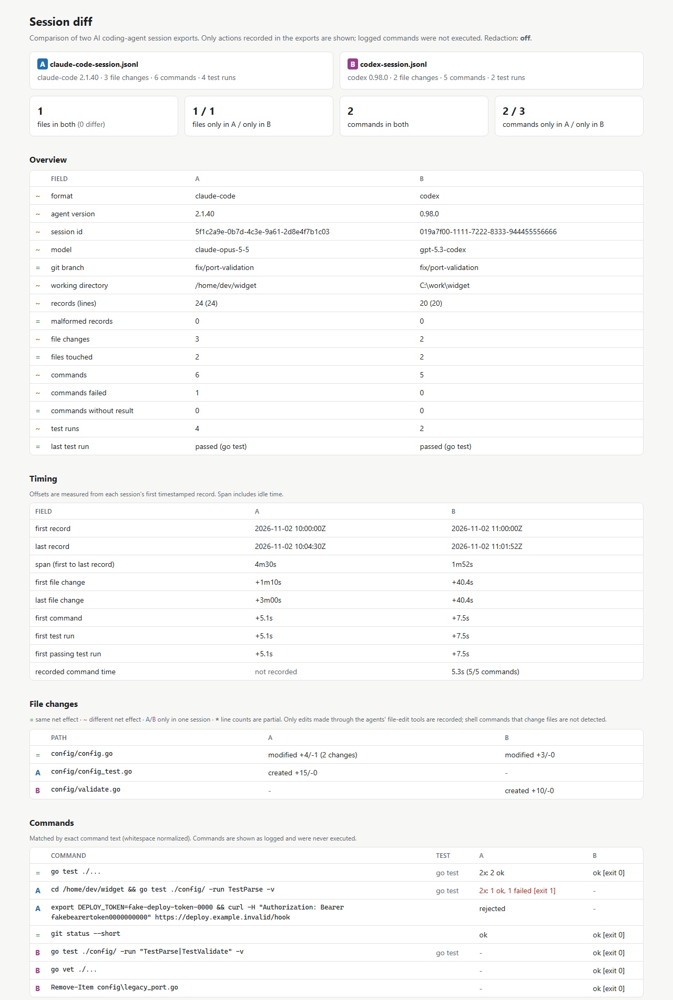

# agent-session-diff

Compare two AI coding-agent session exports side by side: which files each
agent changed, which commands it ran, how its test runs went, and how long it
took. The comparison is built only from what the exports record.

```text
agent-session-diff claude-session.jsonl codex-rollout.jsonl --html report.html
```



## What it guarantees

- **Explicit inputs only.** You pass exactly two files. The tool does not scan
  `~/.claude` or `~/.codex`, find sessions for you, or make network requests.
- **Logged commands are never executed.** No package in this module imports
  `os/exec`, `syscall` or `net`. A test (`TestNoProcessExecution`) enforces this.
- **No inference.** Values come from the exports or are shown as
  `not recorded`. The tool does not fill in a Claude Code exit code of 0 for a
  successful command. It does not compute durations from timestamps. It does
  not turn shell commands such as `rm` or `sed -i` into file changes.
- **Unsupported fields are labelled.** Every report has a field-support table.
  It lists each compared field as recorded, partial (with coverage, for example
  `1/6 commands`), not recorded, or unsupported, with a note explaining why.
- **Deterministic.** The same inputs and flags always give byte-identical
  terminal, HTML and JSON output. There is no "generated at" timestamp. Map
  order never affects output. Results don't depend on the OS the tool runs on.
- **Redaction on request.** `--redact` removes secrets and local paths before
  anything is compared or rendered.

## Install

With Go 1.24 or newer:

```sh
go install github.com/jahau/agent-session-diff/cmd/agent-session-diff@latest
agent-session-diff version
```

Or download a prebuilt binary for Linux, macOS or Windows (amd64 and arm64)
from the [Releases page](https://github.com/jahau/agent-session-diff/releases).
Check the archive against `SHA256SUMS` before you run it:

```sh
sha256sum --check --ignore-missing SHA256SUMS
```

The release archives are reproducible. Building the tagged commit with Go
1.27.4 and `scripts/build-release.sh <tag>` produces byte-identical files.

To build from a checkout: `go build ./cmd/agent-session-diff`.

## Try it on the bundled examples

The repository includes two synthetic sessions of the same small task, one
from Claude Code and one from Codex:

```sh
git clone https://github.com/jahau/agent-session-diff
cd agent-session-diff
go run ./cmd/agent-session-diff examples/claude-code-session.jsonl examples/codex-session.jsonl --html report.html
```

The output should match [examples/report.txt](examples/report.txt). CI checks
that it does.

## Usage

```text
agent-session-diff [flags] <session-a> <session-b>
agent-session-diff inspect [flags] <session>     print one normalized session as JSON
agent-session-diff formats                        list supported export formats
agent-session-diff version
```

| Flag | Meaning |
| --- | --- |
| `--html FILE` | Also write a standalone HTML report (inline CSS, no scripts, no external requests). |
| `--json FILE` | Also write the full comparison as JSON (`-` for stdout). |
| `--format-a`, `--format-b` | `auto` (default), `claude-code` or `codex`. |
| `--label-a`, `--label-b` | Display names (default: file names). |
| `--redact` | Same as `--redact-secrets --redact-paths`. |
| `--redact-secrets` | Replace tokens, API keys, private keys, URL credentials and `password=`/`token=` style assignments with `[REDACTED:kind]`. |
| `--redact-paths` | Replace the session cwd with `<cwd>`, home directories with `<home>`, and other absolute paths with a stable `<path:hash>`. |
| `--limit N` | Rows per section in the terminal summary (default 25, `0` = all). The HTML and JSON reports always contain every row. |
| `--no-color` / `--color` | Disable / force ANSI colors. `NO_COLOR` is honoured. |
| `--quiet` | Skip the terminal summary (for example, when you only want `--html`). |
| `--max-line-bytes N` | Skip, with a warning, any record larger than N bytes (default 32 MiB). |

Exit status: `0` success, `1` a file could not be read or has no supported
format, `2` usage error. Differences between the sessions do not change the
exit status.

Use `--redact` whenever you share a report outside your machine. Exports
contain whatever passed through the agent's terminal.

## Supported formats

Format structure was checked against real exports from Claude Code
2.1.301–2.1.327 and Codex CLI 0.58–0.169 (November 2026). See
[docs/formats.md](docs/formats.md) for the record types that are read, and the
ones that are deliberately not read.

| Format | Typical location | File changes from | Commands from |
| --- | --- | --- | --- |
| `claude-code` | `~/.claude/projects/<project>/<session>.jsonl` | `Write`, `Edit`, `MultiEdit`, `NotebookEdit` tool calls | `Bash`, `PowerShell` tool calls |
| `codex` | `~/.codex/sessions/YYYY/MM/DD/rollout-*.jsonl` | `FileChange` items, `apply_patch` calls (deduplicated by call id) | `CommandExecution` items; `shell`, `shell_command`, `exec_command` calls |

The format is detected from the first records. If detection is ambiguous,
use `--format-a`/`--format-b`.

Known gaps, which also appear in every report's field-support table:

- Claude Code records an exit code only for failed commands, and no command
  duration or per-command working directory.
- Codex unified-exec `exec` script cells are not decoded. Commands they ran
  count only where the export has `CommandExecution` items.
- File changes made by shell commands are invisible to both formats' edit
  records and are not inferred.
- Token usage and conversation text are not compared.

## What is compared

| Section | Contents |
| --- | --- |
| Overview | Format, agent version, session id, model, git branch, cwd, record counts, failures. |
| Timing | First and last record, span, and offsets of the first and last file change, first command, first test run and first passing test run, plus the summed recorded command duration. |
| File changes | One row per path, with net effect (created, modified, deleted, renamed…), +/- lines and number of changes. Paths are made relative to each session's cwd, so a Linux session and a Windows session can match. |
| Commands | One row per command text, with run count, ok/failed/other and the exit codes seen. Matching is by exact text after whitespace normalization. |
| Test runs | Commands whose text starts a known runner (`go test`, `pytest`, `npm test`, `jest`, `vitest`, `cargo test`, `dotnet test`, `rspec`, …). Outcome is the recorded command status. Pass/fail counts appear only if the recorded output has a runner summary line. |
| Field support | Coverage of every field per session, with notes. |
| Not compared | Other tool calls (reads, searches, web, MCP), record types that were not interpreted, and parse warnings. |

### HTML report



The report follows the viewer's light or dark preference
([dark screenshot](docs/screenshots/html-report-dark.png)). A full example
generated from the synthetic sessions in [examples/](examples/) is in
[examples/report.html](examples/report.html), with the matching terminal
output in [examples/report.txt](examples/report.txt).

## Robustness

- Input is streamed line by line. A single record is capped at
  `--max-line-bytes`, so one huge line cannot exhaust memory. 100k records
  parse in well under a second.
- Malformed lines are skipped and counted as warnings: invalid JSON,
  non-object JSON, truncated final records, wrong-typed fields, deep nesting,
  BOMs and CRLF line endings. Parsing continues.
- Files with no recognizable format (empty, plain text, binary) are rejected
  with a clear error, not compared as empty sessions.
- Logged text is escaped in HTML, and control characters are shown as `\xNN`
  in both the terminal and HTML output. A logged ANSI sequence or `<script>`
  cannot affect your terminal or browser. A test feeds a hostile export
  through the tool and checks that the report contains only the template's own
  tags and no event-handler or URL attributes.
- Input files are opened read-only and never modified, with or without
  redaction.

## Development

```sh
go test ./...                              # unit, fixture, malformed, large-input and golden tests
go test ./cmd/... -run TestGolden -update  # refresh golden files after an intended output change
go vet ./...
```

Fixtures in `examples/` and `testdata/` are synthetic and contain no real
session data. The fake credentials in them exist to test redaction.

CI (`.github/workflows/ci.yml`) runs formatting, vet, a no-dependency check,
tests on Linux, macOS and Windows with Go 1.24 and current stable, the race
detector, `govulncheck`, a determinism check, a check that
`examples/report.*` matches the current build, and a double build that proves
the release archives are reproducible.

Releases: pushing a `v*` tag runs `.github/workflows/release.yml`. It tests,
builds the archives and creates a **draft** GitHub release from
`docs/release-notes/<tag>.md`. A maintainer then reviews and publishes it.

## License

MIT. See [LICENSE](LICENSE). The tool has no third-party dependencies. See
[docs/license-review.md](docs/license-review.md).
