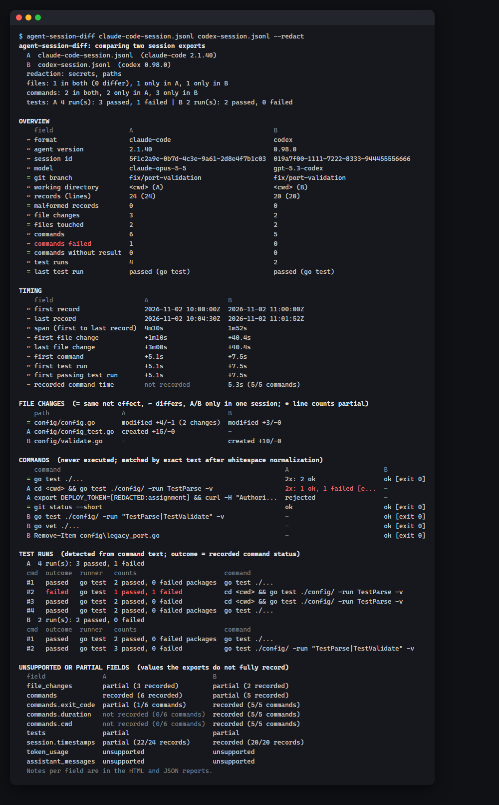

First public release of **agent-session-diff**, a small Go CLI that compares two AI coding-agent session exports from Claude Code or Codex CLI. It shows what each session recorded doing: files changed, commands run, test outcomes and timing.



## Highlights

- **Side-by-side comparison** of file changes (net effect and +/- lines per path), commands (runs, outcomes, exit codes), test runs (runner, outcome, pass/fail counts when the output has them) and timing (span, time to first change, first test, first passing test).
- **Three outputs:** a terminal summary, a standalone HTML report (`--html`, inline CSS, no scripts, light and dark) and a full JSON report (`--json`).
- **Nothing guessed:** values an export doesn't record show as `not recorded`. A field-support table rates every field as recorded, partial (with coverage) or unsupported, with a note explaining why.
- **Safe by construction:** the tool reads only the two files you name, works offline, never executes logged commands, and never modifies its inputs.
- **Shareable reports:** `--redact` removes tokens, keys, credentials, home directories and local paths before anything is rendered.
- **Deterministic:** the same inputs and flags always give byte-identical output.

## Install

```sh
go install github.com/jahau/agent-session-diff/cmd/agent-session-diff@v0.1.0
```

Or download the archive for your platform below. Builds are available for Linux, macOS and Windows on amd64 and arm64. Verify the download, then run it:

```sh
sha256sum --check --ignore-missing SHA256SUMS
tar -xzf agent-session-diff_0.1.0_linux_amd64.tar.gz
./agent-session-diff_0.1.0_linux_amd64/agent-session-diff version
```

The archives are reproducible: building tag `v0.1.0` with Go 1.27.4 and `scripts/build-release.sh v0.1.0` gives byte-identical files.

## Usage

```sh
agent-session-diff session-a.jsonl session-b.jsonl --html report.html
agent-session-diff session-a.jsonl session-b.jsonl --redact --html share.html   # for sharing
agent-session-diff inspect session.jsonl                                       # one session as JSON
agent-session-diff formats                                                     # supported formats
```

To try it on the bundled synthetic examples:

```sh
agent-session-diff examples/claude-code-session.jsonl examples/codex-session.jsonl
```

## Supported formats

| Format | Location | Checked against |
| --- | --- | --- |
| Claude Code session JSONL | `~/.claude/projects/<project>/<session>.jsonl` | 2.1.301 – 2.1.327 |
| Codex CLI rollout JSONL | `~/.codex/sessions/YYYY/MM/DD/rollout-*.jsonl` | 0.58 – 0.169 (all three tool-call generations) |

## Known limitations

- **Claude Code** records an exit code only for failed commands, and records no command duration or per-command working directory. These show as not recorded.
- **Codex** unified-exec `exec` script cells are not decoded. The commands they ran are counted only where the export has `CommandExecution` items, and the report marks commands as partial.
- **Shell file edits:** files changed by shell commands (`sed -i`, `rm`, `git checkout`, redirects) are not detected in either format, and the tool does not infer them.
- **Command matching** is by exact text after whitespace normalization.
- **Test runs** are detected from a fixed list of runners (`go test`, `pytest`, `npm`/`pnpm`/`yarn`/`bun test`, `jest`, `vitest`, `cargo test`, `dotnet test`, `rspec`, …).
- **Not compared:** token usage and conversation text.
- **Format stability:** neither export format is a stable public interface. Unknown record types are listed as "not interpreted" rather than causing errors.

Feedback and format samples (synthetic or redacted) are welcome in the issues.
